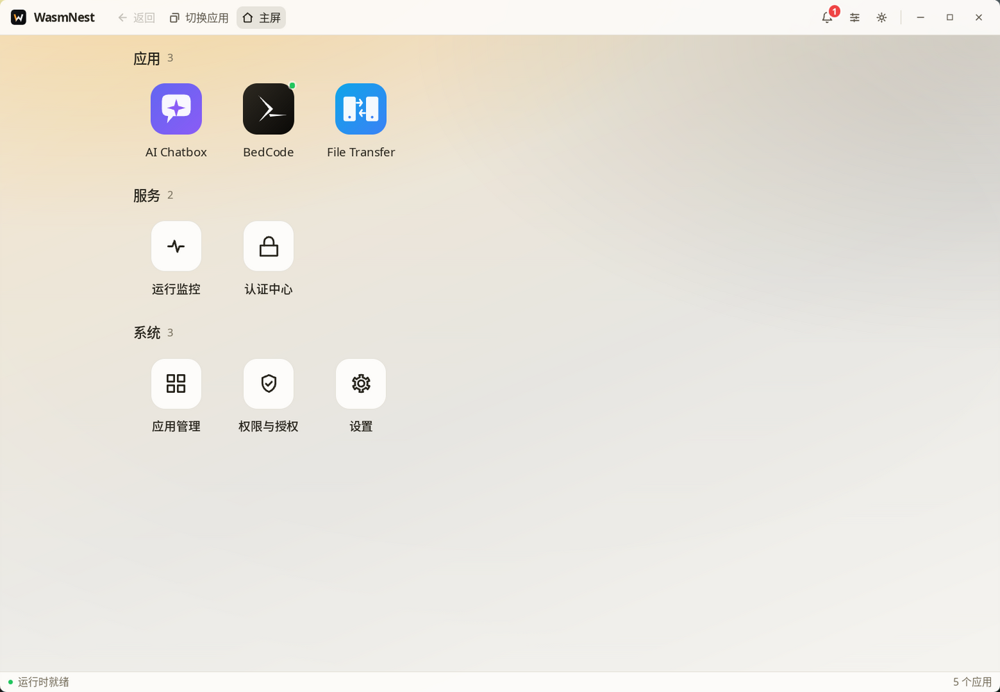
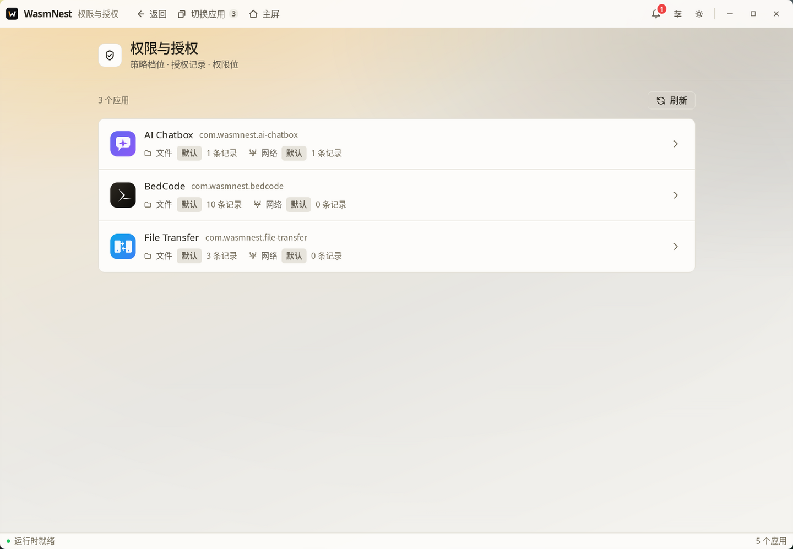
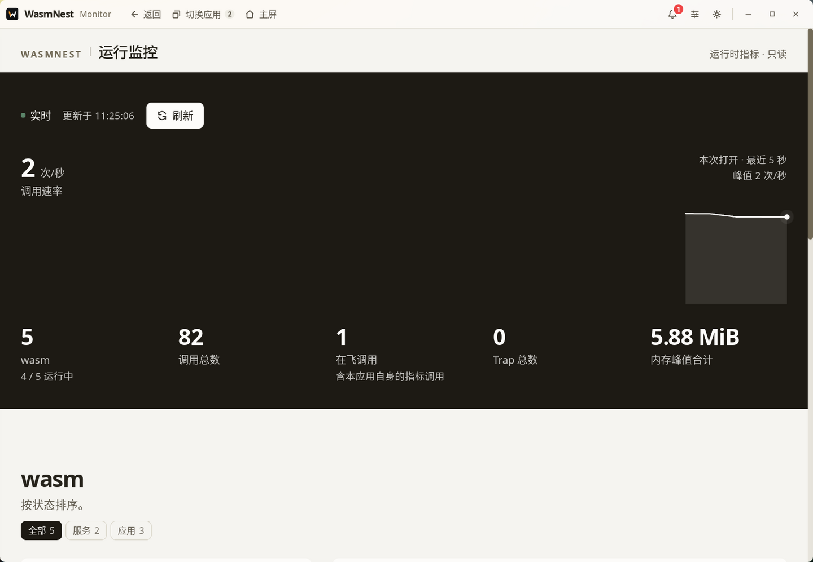
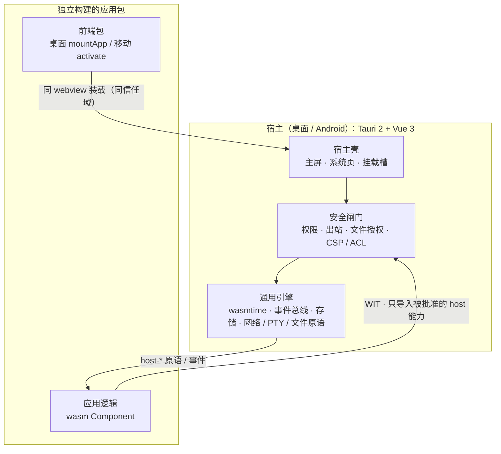

<p align="center">
  
</p>

<h1 align="center">WasmNest</h1>

<p align="center">
  <strong>你的工具，住进你的巢。</strong><br>
  双端 Wasm 应用宿主 —— 能力即权限，宿主保持极简。
</p>

<p align="center">
  <a href="LICENSE"></a>
  <a href="https://github.com/7ZAI/wasmnest/actions/workflows/test.yml"></a>
  <a href="https://github.com/7ZAI/wasmnest/releases/latest"></a>
  <a href="https://tauri.app"></a>
  <a href="https://component-model.bytecodealliance.org"></a>
  <a href="https://wasmtime.dev"></a>
  <a href="#项目状态"></a>
</p>

<p align="center">简体中文 · <a href="README_en.md">English</a></p>

## 目录

- **上手**：[概览](#概览) · [界面](#界面) · [特性](#特性) · [快速开始](#快速开始)
- **了解**：[工作原理](#工作原理) · [四仓协作](#四仓协作) · [双端形态](#双端形态) · [内置应用与服务](#内置应用与服务)
- **参与**：[开发一个应用](#开发一个应用) · [文档](#文档) · [开发与贡献](#开发与贡献) · [项目状态](#项目状态)

## 概览

WasmNest 是一个基于 [WebAssembly Component Model](https://component-model.bytecodealliance.org/) 的双端 wasm 应用宿主：桌面端 Tauri 2 + Vue 3（Windows / Linux），移动端 Tauri 2 + Vue 3（Android）。每个产品能力都被做成可独立构建的 wasm 应用，装进一个薄壳宿主。

它解决的核心问题是**把产品能力从宿主代码中彻底解耦**：终端、AI 对话、文件传输、运行监控不写进宿主，而是作为独立应用装载。应用逻辑在 wasmtime 沙箱中按权限运行；应用不被停用就继续运行，停用 / 卸载才是唯一销毁点。宿主只保留通用引擎、安全闸门与装配机制。

应用前端与宿主同 webview、同可信域；安全边界与威胁模型见 [ADR 0058](docs/adr/0058-frontend-trust-boundary-and-command-surface-threat-model.md)。

WasmNest 希望让人快速构建**属于个人的本地「小程序」平台**：写好一个小工具，装进宿主即装即用；能做什么由权限逐项决定——没有默认授予，只有逐项批准。

> 项目处于研发起步期（`0.0.1`）：暂无真实用户，也没有对外 ABI 兼容义务，接口与形态可能直接调整。稳定的是设计边界，不是版本号。

## 界面

> 桌面宿主实拍（本机运行，非设计稿）。



| 权限与授权 | 运行监控 |
| --- | --- |
|  |  |

## 特性

| 用什么技术 | 达到什么效果 | 解决什么问题 |
| --- | --- | --- |
| **wasmtime 48 沙箱（应用逻辑）**：每个应用独立 Component 实例 + 显式能力导入 | 默认零系统能力，只拿得到被批准的文件、网络等资源 | 应用失控或含恶意代码时，影响半径最小 |
| **WIT / Component Model 跨语言契约**：宿主与应用只通过接口对话，不共享代码 | 应用可用任何能产出 wasm Component 的语言编写 | 插件生态不被宿主语言与运行时锁死 |
| **能力即权限**：`plugin.json` 声明 ∩ 用户批准，无默认授予 | 高风险能力按域拆分、逐项批准；权限页保留按应用的访问记录 | 「装一个应用 = 交出全部权限」 |
| **独立构建的应用包 + 装配机制** | 新增、更换、下架能力不动宿主；停用 / 卸载才销毁回收 | 功能耦合进宿主，改一点就要重发一版 |
| **双端共享同一套 WIT 与 SDK** | 应用写一次，桌面与 Android 都能装载 | 双端生态分裂、重复开发 |
| **薄壳宿主 + 跨仓契约锁** | 宿主只做引擎与装配，契约漂移当场报错 | 宿主随产品膨胀、集成问题静默潜伏 |

## 快速开始

> 不想从源码构建？从 [GitHub Releases](https://github.com/7ZAI/wasmnest/releases/latest) 直接下载 Windows / Linux / Android 安装包。

### 前置要求

- Node.js ≥ 22、pnpm `12.2.1`
- Rust stable 与 **sccache**（必需）
- Tauri 2 系统依赖（[prerequisites](https://v2.tauri.app/start/prerequisites/)）
- 桌面应用构建另需 wasip3 nightly（由 `scripts/wasip3-toolchain.sh` 固定）
- 移动端另需 Android Studio / SDK / NDK / JDK

### 获取与安装

```bash
mkdir wasmnest-workspace && cd wasmnest-workspace
git clone https://github.com/7ZAI/wasmnest.git
git clone https://github.com/7ZAI/wasmnest-lib.git
git clone https://github.com/7ZAI/wasmnest-apps.git
git clone https://github.com/7ZAI/wasmnest-test.git

cd wasmnest
pnpm install
pnpm --dir wasmnest-desktop install
pnpm --dir wasmnest-mobile install
```

首次构建内置应用前，按 [`wasmnest-apps`](https://github.com/7ZAI/wasmnest-apps#readme) 的说明安装各应用工程依赖。

### 运行

```bash
# 桌面宿主（首次启动会自动补建缺失的应用产物）
pnpm --dir wasmnest-desktop run tauri:dev

# 移动宿主
pnpm --dir wasmnest-mobile run tauri:android:dev

# 构建全部内置应用
pnpm --dir wasmnest-desktop run plugins:build
pnpm --dir wasmnest-mobile run plugins:build
```

完整命令与打包方式见 [`docs/commands.md`](docs/commands.md)。

## 工作原理



宿主按 `plugin.json` 校验并授权，把每个应用的 wasm Component 放进独立的 wasmtime 实例；桌面把独立构建的前端包挂进同一 webview，移动注册为宿主壳运行面。

## 四仓协作

WasmNest 由四个平级仓库组成，默认按同场（sibling）布局摆放：

```text
<workspace>/
├─ wasmnest/        平台仓：双端宿主 + 端内 SDK + 构建 / 发布工具
├─ wasmnest-lib/    能力仓：应用无关引擎 + WIT 契约真源
├─ wasmnest-apps/   应用仓：全部业务 wasm 应用
└─ wasmnest-test/   测试仓：跨端真实互连测试
```

| 仓库 | 职责 | 主要内容 |
| --- | --- | --- |
| **[wasmnest](https://github.com/7ZAI/wasmnest)**（本仓） | 宿主与发布面 | 桌面 / 移动宿主、端内 SDK、WIT 拼装、跨仓版本清单 |
| **[wasmnest-lib](https://github.com/7ZAI/wasmnest-lib)** | 可复用机制 | wasm 运行时内核、host API 实现、传输面与能力域引擎 |
| **[wasmnest-apps](https://github.com/7ZAI/wasmnest-apps)** | 业务主场 | BedCode、AI Chatbox、File Transfer、Monitor、Auth Center 等 wasm 应用 |
| **[wasmnest-test](https://github.com/7ZAI/wasmnest-test)** | 跨端门禁 | 真实移动端客户端 ↔ 真实桌面端服务器互连 |

## 双端形态

| | 桌面 | 移动 |
| --- | --- | --- |
| 系统 | Windows / Linux | Android（发布 arm64） |
| 发布产物 | NSIS `.exe`、`.deb`、`.AppImage` | `.apk` |
| 宿主 | Tauri 2 + Vue 3 | Tauri 2 + Vue 3 |
| 应用装载 | 同一窗口全屏挂载独立构建的应用包 | 宿主壳注册运行面 |
| 应用隔离 | wasmtime 沙箱 + 显式能力导入 | 同左，另加内容绑定审批 |

当前发布 Windows、Linux 与 Android；macOS / iOS 未纳入发布验证。

## 内置应用与服务

| 业务应用 | 插件 id | 端 | 能力 |
| --- | --- | --- | --- |
| [**BedCode**](https://github.com/7ZAI/wasmnest-apps/tree/dev/apps/bedcode) | `com.wasmnest.bedcode` | 桌面 + 移动 | 终端会话中心：配对与信任、会话编排、任务队列与 Agent 集成；移动端为远程终端控制端 |
| [**AI Chatbox**](https://github.com/7ZAI/wasmnest-apps/tree/dev/apps/ai-chatbox) | `com.wasmnest.ai-chatbox` | 桌面 + 移动 | 多供应商 AI 对话：流式输出、多会话管理、JSONL 对话日志 |
| [**File Transfer**](https://github.com/7ZAI/wasmnest-apps/tree/dev/apps/file-transfer) | `com.wasmnest.file-transfer` | 桌面 + 移动 | 内网对端发现与双向文件传输：队列、暂停 / 恢复、断点续传、共享目录 |

**系统服务**不进多任务卡，关闭的唯一入口是应用管理页（桌面）/ 应用详情页（移动）的「停用」。

| 系统服务 | 插件 id | 端 | 能力 |
| --- | --- | --- | --- |
| [**Monitor**](https://github.com/7ZAI/wasmnest-apps/tree/dev/servers/monitor) | `com.wasmnest.monitor` | 桌面 + 移动 | 运行监控：只读查看已加载 wasm 应用的运行时指标 |
| [**Auth Center**](https://github.com/7ZAI/wasmnest-apps/tree/dev/servers/auth-center) | `com.wasmnest.auth-center` | 桌面 | 认证中心：本机入站连接的唯一裁决者（fail-closed）；配对码 / QR / 信任 / 认证策略 / 生物凭证 |

## 开发一个应用

应用源码不在本仓，住 [`wasmnest-apps`](https://github.com/7ZAI/wasmnest-apps)。桌面应用是独立挂载包（入口 `mountApp(root, env)`），移动应用是宿主壳运行面（入口 `activate(context)` / `deactivate()`）。`plugin.json` 声明 `id` / `platform` / `permissions` 等字段，权限按最小集声明，未声明即拒。

工程结构、调试与测试要求见应用仓 [README](https://github.com/7ZAI/wasmnest-apps#readme) 与 [AGENTS.md](https://github.com/7ZAI/wasmnest-apps/blob/dev/AGENTS.md)；WIT / 权限 / 挂载契约见 [`docs/contracts.md`](docs/contracts.md)。

## 文档

| 需求 | 入口 |
| --- | --- |
| 开发导航与硬边界 | [`AGENTS.md`](AGENTS.md) |
| 代码地图 / 任务路由 / 锁索引 | [`docs/codemap.md`](docs/codemap.md) |
| 命令全集 | [`docs/commands.md`](docs/commands.md) |
| 架构与宿主薄壳边界 | [`docs/architecture.md`](docs/architecture.md) |
| WIT / 权限 / SDK 契约 | [`docs/contracts.md`](docs/contracts.md) |
| 安全与日志红线 | [`docs/security.md`](docs/security.md) |
| 测试与完成定义 | [`docs/testing.md`](docs/testing.md) |
| 架构决策记录（ADR） | [`docs/adr/`](docs/adr/README.md) |

完整文档索引见 [`docs/codemap.md`](docs/codemap.md) §9。

## 开发与贡献

1. **先读边界**：[`AGENTS.md`](AGENTS.md) 与 [`docs/public/`](docs/public/) 是硬约束，不是建议。
2. **小步提交**：只改任务必要文件；提交信息遵循 Conventional Commits，不添加 AI 生成标记。
3. **实跑验证**：按 [`docs/testing.md`](docs/testing.md) 跑针对性测试，交付说明列出「跑了什么 / 没跑什么 / 风险」。
4. **跨仓改动**：按能力仓 → 平台仓 → 应用仓的顺序提交并打 tag，见 [`docs/git.md`](docs/git.md)。
5. **Issue 优先**：跨会话 backlog 以 [GitHub Issues](https://github.com/7ZAI/wasmnest/issues) 为真源。

## 项目状态

- 版本线 `0.0.1`，研发起步期，接口可能发生破坏性变更。
- 平台仓 tag 形如 `vX.Y.Z`；能力仓 `lib-vX.Y.Z`，应用仓 `apps-vX.Y.Z`，测试仓 `test-vX.Y.Z`。
- 只有发布时才 bump 版本号和打 tag；日常开发不 bump。
- 路线图与任务清单通过 GitHub Issues 维护。

## 致谢

WasmNest 站在这些开源项目之上：[Wasmtime](https://wasmtime.dev) 与 [Bytecode Alliance](https://bytecodealliance.org) 的 Component Model、[Tauri](https://tauri.app)、[Vue](https://vuejs.org)。

## 许可证

[MIT](LICENSE) © 2026 7ZAI
