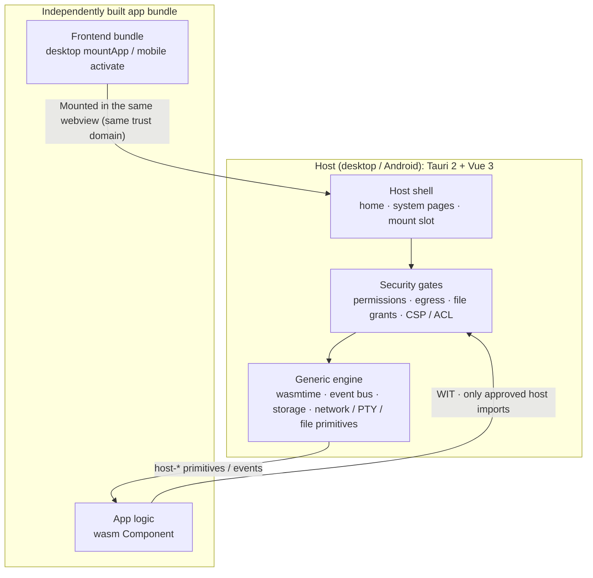

# WasmNest

**A dual-end Wasm application host: one app contract for desktop and Android, with every product capability shipped as an independently built wasm app.**

[](LICENSE)
[](https://github.com/7ZAI/wasmnest/actions/workflows/test.yml)
[](https://tauri.app)
[](https://vuejs.org)
[](https://www.rust-lang.org)
[](https://component-model.bytecodealliance.org)
[](https://wasmtime.dev)
[](#project-status)

English | [简体中文](README.md)

WasmNest is a dual-end wasm application host built on the [WebAssembly Component Model](https://component-model.bytecodealliance.org/): Tauri 2 + Vue 3 (Windows / macOS / Linux) on desktop, Tauri 2 (Android) + Vue 3 on mobile.

The core problem it solves: **decoupling product capabilities from host code entirely**. Terminals, AI chat, file transfer, agent management — none of them live in the host. Each ships as an independently loaded wasm app: the app logic (wasm Component) runs in a wasmtime sandbox under explicit permissions, while the app frontend shares the host's webview and trust domain (see [ADR 0058](docs/adr/0058-frontend-trust-boundary-and-command-surface-threat-model.md)); an app keeps running until it is disabled — switching away only hides it, and disable / uninstall is the only destroy point. The host only provides the generic engine, security gates and assembly — apps can grow freely while the host stays minimal.

## Goal

WasmNest is committed to making it fast to build **personal local "mini-programs"** — your own **small-tools platform**: write a small tool, drop it into the host and it just works; tools run on your own device, and what they can do is decided by permissions — nothing granted by default, everything approved explicitly.

> The project is in its early development phase (`0.0.1`): there are no real users yet and no external ABI compatibility obligations, so interfaces and shapes may change directly. What is stable is the design boundary, not the version number.

## Features and Advantages

| Technology | Effect | Problem it solves |
| --- | --- | --- |
| **wasmtime sandbox (app logic)**: one isolated Component instance per app with explicit capability imports; the app frontend is not sandboxed — it shares the host's webview and trust domain ([ADR 0058](docs/adr/0058-frontend-trust-boundary-and-command-surface-threat-model.md)) | App logic starts with zero system capabilities and only gets the file / network access it was approved for | A runaway or malicious app has its logic contained to the smallest possible radius |
| **WIT / Component Model cross-language contracts**: host and app talk only through interfaces, sharing no code | Apps can be written in any language that can emit a wasm Component; the host doesn't care about language or toolchain | Plugin ecosystems locked to the host's language and runtime |
| **Capability is permission**: `plugin.json` declarations ∩ user approval, nothing granted by default | What an app can do is decided by the user, with high-risk abilities split by domain | Installing an app means handing over all permissions |
| **Independently built app bundles + assembly mechanism** | Add, swap or remove capabilities without touching the host; apps are destroyed only on disable / uninstall | Features coupled into the host, forcing a full release for every change |
| **One shared WIT and SDK across both ends** | Write an app once, load it on desktop and Android | Split ecosystems and duplicated work |
| **Thin host + cross-repo version fingerprints** | The host only does engines and assembly; contract drift fails immediately | Host bloat and integration issues lurking silently |

## Design Principles

| Principle | Meaning |
| --- | --- |
| **Thin host** | The host only answers "how does the mechanism work", never "what is this feature, who is it for, how is it organized". Types, flows, storage, defaults and lifecycle callbacks defined by product semantics all belong to apps; this boundary is pinned by test locks. |
| **Capability is permission** | Nothing is granted by default. Effective permissions = declarations in `plugin.json` ∩ user approval; high-risk surfaces such as files, network, processes, PTY and WebSocket are split by domain. On mobile, approval is pinned to content SHA-256, so replacing the directory automatically revokes it. |
| **Contract first** | The core WIT lives in the capability repo; end composition and SDK artifacts live in the platform repo. Cross-repo versions are pinned by [`release-manifest.json`](release-manifest.json) using exact tags, contract versions and WIT fingerprints — any drift turns red. |
| **Dual-end lockstep** | Both ends share one mechanism core and one wasmtime version, while their assembly surfaces evolve separately. Cross-end protocols (HTTP / WS / auth / file transfer) must be deployed on both ends together. |

## How It Works



The capability repo provides the WIT contract source and engine implementations, the apps repo provides all business app sources, and `release-manifest.json` pins their cross-repo versions.

The full load-to-destroy loop:

1. **Scan and validate**: the host scans bundled `resources/plugins/<end>/<id>/` and the user install directory, then validates the end, required fields and permission declarations in `plugin.json`; missing items are rejected.
2. **Authorize**: effective permissions = manifest declarations ∩ user approval. Mobile approval is pinned to the directory content SHA-256; replacing the content revokes it automatically.
3. **Instantiate**: each app's wasm Component runs in its own wasmtime instance and only receives the approved host imports.
4. **Mount the UI**: desktop mounts the independently built frontend bundle into the same webview via `mountApp(root, env)`; mobile registers it as a host-shell runtime surface.
5. **Lifecycle**: switching away only hides the app (DOM / component instances are retained); disable / uninstall is the only destroy point and revokes permissions. Uninstall also clears storage and the private database.

## Desktop and Mobile

| | Desktop | Mobile |
| --- | --- | --- |
| Host | Tauri 2 + Vue 3 (Windows / macOS / Linux) | Tauri 2 + Vue 3 (Android) |
| App loading | Full-screen mount of an independently built app bundle in the same window | Runtime surface registration in the host shell |
| App isolation | App logic: wasmtime sandbox instance + explicit capability imports; app frontend shares the host's webview and trust domain ([ADR 0058](docs/adr/0058-frontend-trust-boundary-and-command-surface-threat-model.md)) | Same, plus content-bound approval on Android |

An app keeps running as long as it is not disabled — switching away only hides it (DOM / component instances are retained); disable / uninstall is the only destroy point, and the host shell holds no app-internal state. Assembly details: [`docs/architecture.md`](docs/architecture.md), [`docs/frontend.md`](docs/frontend.md).

## Four Repositories

WasmNest consists of four peer repositories, expected in a sibling layout:

```text
<workspace>/
├─ wasmnest/        platform: dual-end hosts + per-end SDKs + build / release tooling
├─ wasmnest-lib/    capability: application-agnostic engines + WIT contract source of truth
├─ wasmnest-apps/   applications: all business wasm apps
└─ wasmnest-test/   testing: real cross-end integration tests (zero mocks)
```

| Repository | Role | Contents |
| --- | --- | --- |
| **[wasmnest](https://github.com/7ZAI/wasmnest)** (this repo) | Host and release surface | Desktop / mobile hosts, per-end SDKs, WIT composition, cross-repo version manifest, build and packaging tools |
| **[wasmnest-lib](https://github.com/7ZAI/wasmnest-lib)** | Reusable mechanisms | wasm runtime core, host API implementation layer, server transports, PTY / mDNS / notify / crypto engines, contract constants |
| **[wasmnest-apps](https://github.com/7ZAI/wasmnest-apps)** | Business home | BedCode, AI Chatbox, File Transfer and other wasm apps (Agent Hub merged into BedCode) |
| **[wasmnest-test](https://github.com/7ZAI/wasmnest-test)** | Cross-end gate | Real mobile client ↔ real desktop server interop, cross-repo contract locks |

The platform consumes the capability repo directly through Cargo sibling paths (no copies, no submodules). Non-standard layouts can override `WASMNEST_LIB_ROOT` and `WASMNEST_APPS_ROOT`; a missing directory fails visibly instead of returning a possibly invalid path.

## Built-in Apps and Services

All business apps live in the apps repo; the tables below list the built-ins shipped with the host.

| Business app | Plugin id | Ends | Capability |
| --- | --- | --- | --- |
| [**BedCode**](https://github.com/7ZAI/wasmnest-apps/tree/dev/apps/bedcode) | `com.wasmnest.bedcode` | desktop + mobile | Terminal session center: pairing and trust, session lifecycle orchestration, task queue and agent integration; the mobile side is a remote terminal controller |
| [**AI Chatbox**](https://github.com/7ZAI/wasmnest-apps/tree/dev/apps/ai-chatbox) | `com.wasmnest.ai-chatbox` | desktop + mobile | Multi-provider AI chat: streaming output, multi-session management, JSONL conversation logs |
| [**File Transfer**](https://github.com/7ZAI/wasmnest-apps/tree/dev/apps/file-transfer) | `com.wasmnest.file-transfer` | desktop + mobile | LAN peer discovery and bidirectional file transfer: queues, pause/resume, resumable transfers, shared directories |

**System services** (assembly role `internal-business`) do not appear in the task switcher; the only close entry is "Disable" on the app management page (desktop) / app details page (mobile).

| System service | Plugin id | Ends | Capability |
| --- | --- | --- | --- |
| [**Monitor**](https://github.com/7ZAI/wasmnest-apps/tree/dev/servers/monitor) | `com.wasmnest.monitor` | desktop + mobile | Runtime monitoring: read-only runtime metrics for all loaded wasm apps (memory / calls / fuel / traps / quotas) |
| [**Auth Center**](https://github.com/7ZAI/wasmnest-apps/tree/dev/servers/auth-center) | `com.wasmnest.auth-center` | desktop | Authentication center: the sole fail-closed authority for inbound connections; pairing codes / QR / trust / first-connect confirmation / auth policy / biometric credentials |

## Quick Start

### Prerequisites

| Dependency | Notes |
| --- | --- |
| Node.js | ≥ 22 (development uses 24) |
| pnpm | `12.2.1`, pinned by the root `package.json` `packageManager`; `corepack enable` is recommended |
| Rust | stable (development uses 1.98); desktop apps also need the wasip3 nightly pinned by `scripts/wasip3-toolchain.sh` |
| sccache | **Required.** The root `.cargo/config.toml` forces `rustc-wrapper = "sccache"`; without it cargo fails immediately (intentional) |
| Tauri 2 | Desktop system dependencies: [Tauri prerequisites](https://v2.tauri.app/start/prerequisites/) |
| Android | Mobile only: Android Studio / SDK / NDK / JDK, versions matching the Tauri 2 Android toolchain |

### Clone the Four Repositories

```bash
mkdir wasmnest-workspace && cd wasmnest-workspace
git clone https://github.com/7ZAI/wasmnest.git
git clone https://github.com/7ZAI/wasmnest-lib.git
git clone https://github.com/7ZAI/wasmnest-apps.git
git clone https://github.com/7ZAI/wasmnest-test.git
```

### Install Dependencies

```bash
cd wasmnest

# Root dependencies (eslint / prettier / husky / root scripts)
pnpm install

# Each host is an independent workspace and must be installed separately
pnpm --dir wasmnest-desktop install
pnpm --dir wasmnest-mobile install

# WIT artifacts match their sources (day-to-day gate)
pnpm run check:wit

# App repo root dependencies + every app project (each app is its own pnpm workspace)
cd ../wasmnest-apps
pnpm install
for app in apps/*/desktop apps/*/mobile; do
  [ -f "$app/package.json" ] && (cd "$app" && pnpm install)
done

# Back to the platform repo root; the remaining commands run from here
cd ../wasmnest
```

> `pnpm run check:manifest` validates **release assembly state**: the HEAD of `../wasmnest-lib` and `../wasmnest-apps` must sit exactly on the tags pinned by the manifest (with clean working trees). Day-to-day branches usually lead the tags, so a red result there is expected.

The test repo is not part of the day-to-day build; when changing cross-end protocols (HTTP / WS / auth / file transfer), enter `../wasmnest-test`, install its dependencies and run the real interop suite.

### Run the Desktop Host

From the platform repo root:

```bash
pnpm --dir wasmnest-desktop run tauri:dev
```

The first launch automatically builds missing or stale app artifacts and starts the plugin watcher. If app dependencies are not installed yet, finish the previous step first.

### Run the Mobile Host

From the platform repo root:

```bash
pnpm --dir wasmnest-mobile run tauri:android:dev
```

Requires a working Android device or emulator. After app changes land in the host, the app must be re-activated manually.

### Build All Apps

From the platform repo root:

```bash
pnpm --dir wasmnest-desktop run plugins:build
pnpm --dir wasmnest-mobile run plugins:build
```

Artifacts are written to `src-tauri/resources/plugins/<end>/<id>/`, which is not tracked. During desktop development the runtime copy lives in `target/debug/resources/plugins/desktop/`; deleting the source directory does not synchronize that copy. To produce a distributable host, run `pnpm run host:pack` in the desktop end to generate assets under `dist-host/` (see [`docs/commands.md`](docs/commands.md) §3).

## Develop an App

App sources do not live in this repo: business apps live in [`wasmnest-apps`](https://github.com/7ZAI/wasmnest-apps), while this repo owns the hosts, per-end SDKs, loading and packaging.

1. **Pick the end and form**: desktop apps are independently built mount bundles with a `mountApp(root, env)` entry; mobile apps are host-shell runtime surfaces with `activate(context)` / `deactivate()` entries. File Transfer is the dual-end single-Rust-artifact exception (mobile uses a `desktop-compat` stub).
2. **Declare the manifest**: `plugin.json` states `id` / `platform` / `pluginType` / `permissions` / `contributes`; declare the minimum permission set, since undeclared means denied.
3. **Debug locally**: for mobile, run `pnpm run dev` inside the app project for the SDK dev-shell (HMR); for desktop, use `pnpm run tauri:dev` in the desktop end to load real artifacts, or `dev:host` inside the app project (run `pnpm run host:pack` first to produce a host runtime).
4. **Wire and register**: build built-in apps with `pnpm run plugins:build` in the desktop / mobile end, and debug one app with `pnpm run plugins:dev -- --plugin <id>` on desktop; adding / renaming / disabling an app also requires updating `release-manifest.json`, and desktop apps additionally need their build and route registries updated (checklist in [`docs/codemap.md`](docs/codemap.md) §6).
5. **Contracts and tests**: see [`docs/contracts.md`](docs/contracts.md) for WIT / permissions / mount contracts, and the apps repo [README](https://github.com/7ZAI/wasmnest-apps#readme) plus [AGENTS.md](https://github.com/7ZAI/wasmnest-apps/blob/dev/AGENTS.md) for project layout, entry contracts and test requirements.

## Common Commands

| Location | Command | Purpose |
| --- | --- | --- |
| Platform root | `pnpm run check:wit` | WIT composition drift lock (day-to-day gate) |
| Platform root | `pnpm run check:links` | Markdown dead-link lock |
| Platform root | `pnpm run test:run` | Root script self-tests |
| Platform root | `pnpm run check:manifest` | Release assembly consistency (usually red on development branches) |
| Desktop | `pnpm run tauri:dev` | Host development (prebuild gaps + frontend watch) |
| Desktop | `pnpm run plugins:dev -- --plugin <id>` | Debug a single app |
| Desktop / Mobile | `pnpm run plugins:build` | Build all built-in apps |
| Desktop / Mobile | `pnpm run test:run` | Host and SDK vitest suites |
| Desktop / Mobile | `cd src-tauri && cargo test` | Host Rust tests (some e2e tests need bundled artifacts) |
| Mobile | `pnpm run tauri:android:dev` | Android development |

> Always use pnpm. **Do not run `pnpm run test`** (vitest watch never exits); use `test:run`. For the full command set (release packaging such as `tauri:build` / `host:pack`, `cargo test`, E2E, etc.) see [`docs/commands.md`](docs/commands.md).

## Project Layout

```text
wasmnest/
├─ wasmnest-desktop/            # Tauri 2 desktop host
│  ├─ src/                      # Host shell (home / system pages / mount slot / task preview)
│  ├─ src-tauri/                # Rust host: plugin wiring + security gates + server
│  ├─ packages/plugin-sdk-desktop/  # in-end SDK (bin/ dev tools + tools/componentize ship with the npm package)
│  ├─ scripts/                  # dev-run / plugin-build / host:pack
│  └─ e2e/ · bench/
├─ wasmnest-mobile/             # Tauri 2 Android host
│  ├─ src/                      # Host shell (shell registry + runtime surfaces)
│  ├─ src-tauri/                # Rust host + hand-written Kotlin under gen/android
│  └─ packages/plugin-sdk-mobile/
├─ scripts/                     # WIT composition / manifest checks / path resolvers / packaging / versions
├─ docs/                        # Architecture / contracts / frontend / backend / security / testing / git
│  ├─ adr/                      # Architecture decision records (ADRs)
│  ├─ public/                   # Conventions shared by the four repos
│  └─ knowledge/                # wasm app development checklist
├─ release-manifest.json        # Single expression of cross-repo versions
└─ AGENTS.md                    # Development navigation and hard boundaries (humans and AI agents)
```

## Architecture and Contracts

**Overall architecture diagram**: [`docs/architecture/wasmnest-overall.html`](docs/architecture/wasmnest-overall.html) — an interactive single-file diagram generated by archify; open it in a browser after cloning (on github.com the link only shows the source).

### WIT Source Chain

```text
capability repo wit/core.wit + domain wit/<domain>.wit + wasmnest-contract
        │
        ├─ platform compose.json (declares which fragments this end composes)
        │        └─ node scripts/compose-wit.mjs --all
        ▼
rust/wit/** inside both SDKs (generated, never hand-edited, pinned by drift locks)
```

The contract version is part of the wasm import name. If host and guest versions diverge, instantiation names the missing interface and the version to rebuild — it never degrades silently.

### Cross-repo Versions

`release-manifest.json` validates the platform version, the exact capability-repo HEAD tag, the exact apps-repo HEAD tag, the contract version, both WIT fingerprints and each end's artifact name; its `hostRuntime` section separately records the host runtime version, build commit and sha256 of the platform distribution assets. The release order is **capability repo → platform repo → apps repo**. Local changes without a tag never enter a release assembly.

### Security Gates

- **Permissions**: nothing is granted by default; undeclared means denied. High-risk surfaces are split by domain (`pty:spawn` / `pty:io`, `ws:client` / `ws:server`, `fs:pick` / `fs:read` / `fs:write`, etc.).
- **Egress**: three-layer decision (target allowlist → declared URL → memory) plus a one-time grant prompt on a miss; headless / test contexts without an `AppHandle` fail closed.
- **Frontend**: Tauri ACL + CSP + static lint form a three-layer blockade; frontend code cannot touch network / file / navigation primitives directly. The blockade does not cover IPC — plugin frontends in the same webview can reach the host command surface via `invoke`; the trust boundary and its convergence ruling are documented in [ADR 0058](docs/adr/0058-frontend-trust-boundary-and-command-surface-threat-model.md).
- **Error envelope**: cross-process failures use `{ code, request_id, params? }`, where `code` is the frontend i18n key; technical details stay in host logs.

### Tests and Locks

Many design constraints exist as executable locks: zero business types in the host, CSP blockade, command registration completeness, hot-path logging, byte-identical i18n, WIT / permission vocabulary / wire drift, and more. When a lock's allowlist legitimately changes, update it in the same commit; never delete a lock or hollow out its assertions. Cross-end protocol changes must also pass the real interop suite in the test repo.

## FAQ

| Symptom | Cause / fix |
| --- | --- |
| `check:manifest` is red although nothing is broken | It validates **release assembly**: the capability / apps repo HEAD must sit exactly on the tags pinned by the manifest. Development branches usually lead those tags, so red is expected; only release / tag pipelines need it green. |
| Cargo fails immediately with `sccache` not found | The root `.cargo/config.toml` forces `rustc-wrapper = "sccache"`; install it and make sure it is on PATH. This failure is intentional — do not work around it. |
| App changes do not show up in the host | Verify the artifacts were written to `src-tauri/resources/plugins/<end>/<id>/`; the desktop dev runtime copy lives in `target/debug/resources/plugins/desktop/` and is not synchronized when the source directory is deleted or rebuilt. Rebuild with `plugins:build` / `plugins:dev` instead of copying by hand. |
| First launch reports a missing app | App dependencies are not installed or artifacts were not built. Finish the app-repo installs, then run `plugins:build`, and confirm the sibling layout. |
| `pnpm run test` never exits | It is vitest watch mode; always use `test:run`. |
| Android device not found / wireless debugging disconnects | Run `adb devices -l` first; pairing, reverse tunnels and multi-device handling are in [`docs/commands.md`](docs/commands.md) §4.1. |

## Documentation

| Need | Entry point |
| --- | --- |
| Development navigation and hard boundaries | [`AGENTS.md`](AGENTS.md) |
| Code map / task routing / lock index | [`docs/codemap.md`](docs/codemap.md) |
| Full command set | [`docs/commands.md`](docs/commands.md) |
| Architecture and the thin-host boundary | [`docs/architecture.md`](docs/architecture.md) |
| Overall architecture diagram | [`docs/architecture/wasmnest-overall.html`](docs/architecture/wasmnest-overall.html) |
| Architecture decision records (ADRs) | [`docs/adr/`](docs/adr/README.md) |
| Plugin / SDK / WIT contracts | [`docs/contracts.md`](docs/contracts.md) |
| Frontend conventions | [`docs/frontend.md`](docs/frontend.md) |
| Rust backend conventions | [`docs/backend.md`](docs/backend.md) |
| Security and logging red lines | [`docs/security.md`](docs/security.md) |
| Testing and definition of done | [`docs/testing.md`](docs/testing.md) |
| Git and cross-repo commit order | [`docs/git.md`](docs/git.md) |
| Dependency direction and forbidden actions | [`docs/boundaries.md`](docs/boundaries.md) |
| Shared conventions across the four repos | [`docs/public/`](docs/public/) |

## Development and Contributing

1. **Read the boundaries first**: [`AGENTS.md`](AGENTS.md) and [`docs/public/`](docs/public/) (git, comments and naming, testing, versioning, issue management). Hard constraints and security red lines are not suggestions.
2. **Commit in small steps**: touch only files the task needs, avoid unrelated refactors, and follow Conventional Commits without AI-generated signatures.
3. **Verify by running**: gates are CI required checks (PR: `check-wit` / `node-root` / `node-desktop` / `node-mobile` / `rust-check`) + husky pre-commit + local commands + test locks; full `cargo test` and bundled-artifact e2e run on mainline pushes (currently `dev`) and nightly. Skipping a hook does not mean the gate passed — run it manually and report what ran, what did not, and the risk.
4. **Cross-repo changes**: commit and tag in the order capability repo → platform repo → apps repo, then update `release-manifest.json` and run `check:manifest`.
5. **Issues first**: the cross-session backlog lives in [GitHub Issues](https://github.com/7ZAI/wasmnest/issues); bug / feature / contract-change templates are provided in the repo.

## Project Status

- Version line `0.0.1`, early development; interfaces may change destructively.
- Platform tags look like `vX.Y.Z`; capability `lib-vX.Y.Z`, apps `apps-vX.Y.Z`, tests `test-vX.Y.Z`.
- Versions and tags are bumped only for releases; day-to-day development does not bump.
- CI layers are defined in [`.github/workflows/test.yml`](.github/workflows/test.yml): PRs run the node layer and fast Rust checks; mainline pushes (currently `dev`) and nightly run the full `cargo test` suite plus bundled-artifact e2e.
- Roadmap and task backlog are maintained in GitHub Issues.

## License

[MIT](LICENSE) © 2026 7ZAI
