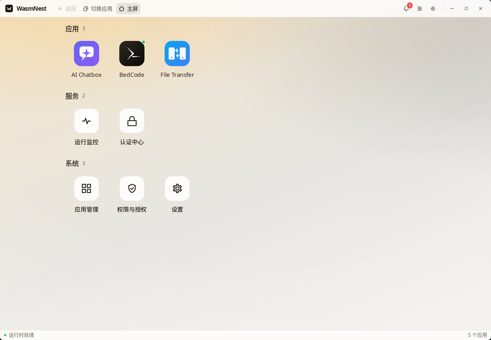
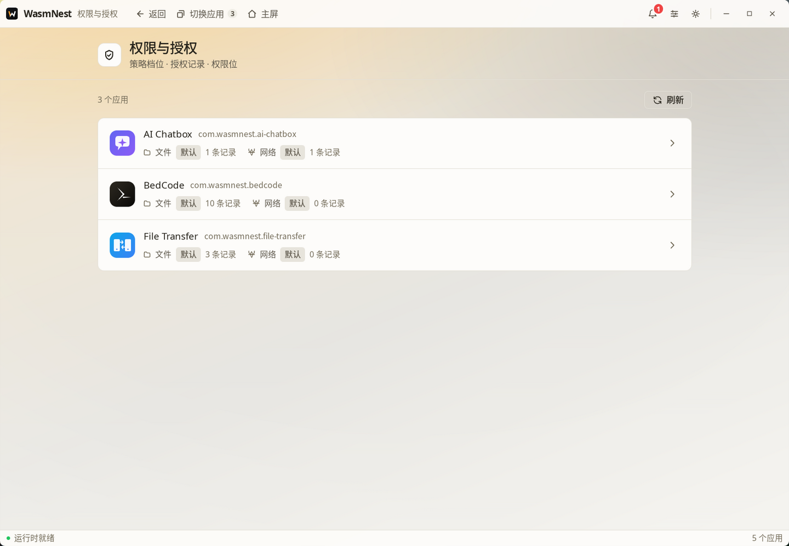
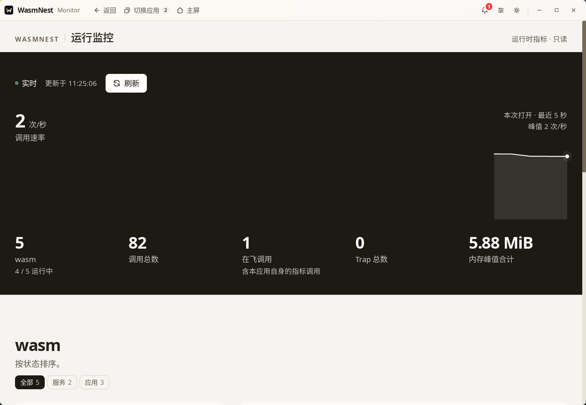
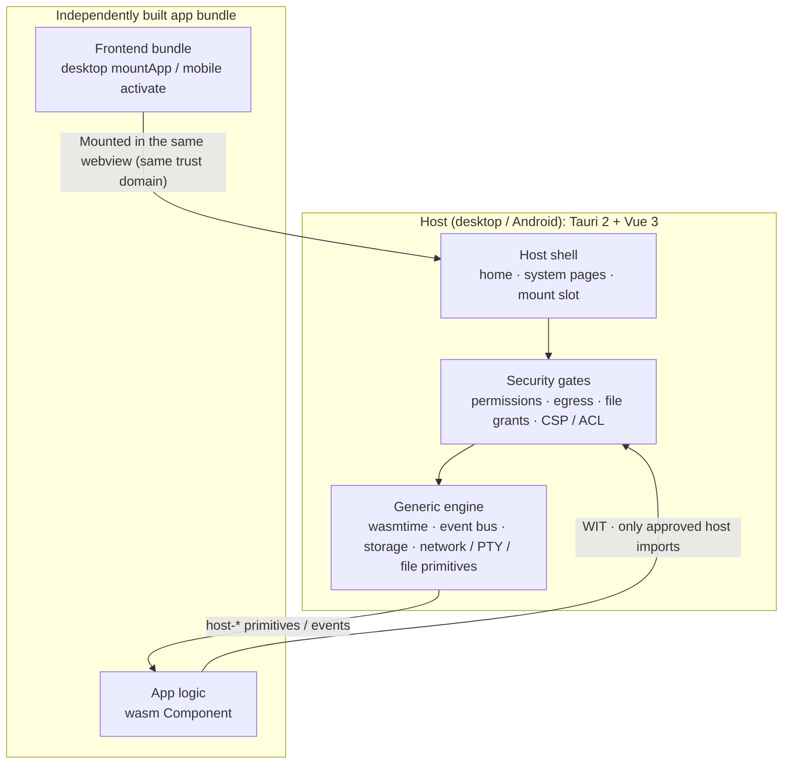

<p align="center">
  
</p>

<h1 align="center">WasmNest</h1>

<p align="center">
  <strong>Your tools. Your nest. Your rules.</strong><br>
  A dual-end Wasm app host — capability is permission, the host stays thin.
</p>

<p align="center">
  <a href="LICENSE"></a>
  <a href="https://github.com/7ZAI/wasmnest/actions/workflows/test.yml"></a>
  <a href="https://github.com/7ZAI/wasmnest/releases/latest"></a>
  <a href="https://tauri.app"></a>
  <a href="https://component-model.bytecodealliance.org"></a>
  <a href="https://wasmtime.dev"></a>
  <a href="#project-status"></a>
</p>

<p align="center"><a href="README.md">简体中文</a> · English</p>

## Contents

- **Get started**: [Overview](#overview) · [Screenshots](#screenshots) · [Features](#features) · [Quick Start](#quick-start)
- **Learn more**: [How It Works](#how-it-works) · [Four Repositories](#four-repositories) · [Desktop and Mobile](#desktop-and-mobile) · [Built-in Apps and Services](#built-in-apps-and-services)
- **Participate**: [Develop an App](#develop-an-app) · [Documentation](#documentation) · [Development and Contributing](#development-and-contributing) · [Project Status](#project-status)

## Overview

WasmNest is a dual-end wasm application host built on the [WebAssembly Component Model](https://component-model.bytecodealliance.org/): Tauri 2 + Vue 3 on desktop (Windows / Linux), Tauri 2 + Vue 3 on mobile (Android). Every product capability ships as an independently built wasm app loaded into a thin host shell.

The core problem it solves is **fully decoupling product capabilities from host code**: terminals, AI chat, file transfer and runtime monitoring do not live in the host; they are loaded as separate apps. App logic runs in a wasmtime sandbox under explicit permissions. An app keeps running until it is disabled — disable / uninstall is the only destroy point. The host keeps only the generic engine, security gates and assembly mechanism.

An app's frontend shares the host's webview and trust domain; the security boundary and threat model are documented in [ADR 0058](docs/adr/0058-frontend-trust-boundary-and-command-surface-threat-model.md).

WasmNest aims to make it fast to build **a personal local "mini-programs" platform**: write a small tool, drop it into the host and it just works; what it can do is decided permission by permission — nothing granted by default, everything approved explicitly.

> The project is in its early development phase (`0.0.1`): there are no real users yet and no external ABI compatibility obligations, so interfaces and shapes may change directly. What is stable is the design boundary, not the version number.

## Screenshots

> Captured from the real desktop host (running locally, not a design mock).



| Permissions and authorization | Runtime monitor |
| --- | --- |
|  |  |

## Features

| Technology | Effect | Problem it solves |
| --- | --- | --- |
| **wasmtime 48 sandbox (app logic)**: one isolated Component instance per app with explicit capability imports | Zero system capabilities by default; only the file / network access it was approved for | A runaway or malicious app is contained to the smallest possible radius |
| **WIT / Component Model cross-language contracts**: host and app talk only through interfaces, sharing no code | Apps can be written in any language that can emit a wasm Component | Plugin ecosystems locked to the host's language and runtime |
| **Capability is permission**: `plugin.json` declarations ∩ user approval, nothing granted by default | High-risk abilities are split by domain and approved individually; the permissions page keeps per-app access records | "Installing an app means handing over all permissions" |
| **Independently built app bundles + assembly mechanism** | Add, swap or remove capabilities without touching the host; apps are destroyed only on disable / uninstall | Features coupled into the host, forcing a full release for every change |
| **One shared WIT and SDK across both ends** | Write an app once, load it on desktop and Android | Split ecosystems and duplicated work |
| **Thin host + cross-repo contract locks** | The host only does engines and assembly; contract drift fails immediately | Host bloat and integration issues lurking silently |

## Quick Start

> Don't want to build from source? Download the Windows / Linux / Android installers directly from [GitHub Releases](https://github.com/7ZAI/wasmnest/releases/latest).

### Prerequisites

- Node.js ≥ 22 and pnpm `12.2.1`
- Rust stable and **sccache** (required)
- Tauri 2 system dependencies ([prerequisites](https://v2.tauri.app/start/prerequisites/))
- Desktop app builds also need the wasip3 nightly pinned by `scripts/wasip3-toolchain.sh`
- Mobile builds also need Android Studio / SDK / NDK / JDK

### Clone and Install

```bash
mkdir wasmnest-workspace && cd wasmnest-workspace
git clone https://github.com/7ZAI/wasmnest.git
git clone https://github.com/7ZAI/wasmnest-lib.git
git clone https://github.com/7ZAI/wasmnest-apps.git
git clone https://github.com/7ZAI/wasmnest-test.git

cd wasmnest
pnpm install
pnpm --dir wasmnest-desktop install
pnpm --dir wasmnest-mobile install
```

Before building built-in apps for the first time, install each app project's dependencies as described in the [`wasmnest-apps`](https://github.com/7ZAI/wasmnest-apps#readme) README.

### Run

```bash
# Desktop host (prebuilds missing app artifacts on first launch)
pnpm --dir wasmnest-desktop run tauri:dev

# Mobile host
pnpm --dir wasmnest-mobile run tauri:android:dev

# Build all built-in apps
pnpm --dir wasmnest-desktop run plugins:build
pnpm --dir wasmnest-mobile run plugins:build
```

For the full command set and packaging, see [`docs/commands.md`](docs/commands.md).

## How It Works



The host validates and authorizes each app via `plugin.json`, then runs its wasm Component in an isolated wasmtime instance. Desktop mounts the independently built frontend bundle into the same webview; mobile registers it as a host-shell runtime surface.

## Four Repositories

WasmNest consists of four peer repositories, expected in a sibling layout:

```text
<workspace>/
├─ wasmnest/        platform: dual-end hosts + per-end SDKs + build / release tooling
├─ wasmnest-lib/    capability: application-agnostic engines + WIT contract source of truth
├─ wasmnest-apps/   applications: all business wasm apps
└─ wasmnest-test/   testing: real cross-end integration tests
```

| Repository | Role | Contents |
| --- | --- | --- |
| **[wasmnest](https://github.com/7ZAI/wasmnest)** (this repo) | Host and release surface | Desktop / mobile hosts, per-end SDKs, WIT composition, cross-repo version manifest |
| **[wasmnest-lib](https://github.com/7ZAI/wasmnest-lib)** | Reusable mechanisms | wasm runtime core, host API implementations, transports and capability engines |
| **[wasmnest-apps](https://github.com/7ZAI/wasmnest-apps)** | Business home | BedCode, AI Chatbox, File Transfer, Monitor, Auth Center and other wasm apps |
| **[wasmnest-test](https://github.com/7ZAI/wasmnest-test)** | Cross-end gate | Real mobile client ↔ real desktop server interop |

## Desktop and Mobile

| | Desktop | Mobile |
| --- | --- | --- |
| OS | Windows / Linux | Android (arm64 releases) |
| Release artifacts | NSIS `.exe`, `.deb`, `.AppImage` | `.apk` |
| Host | Tauri 2 + Vue 3 | Tauri 2 + Vue 3 |
| App loading | Full-screen mount of an independently built app bundle in the same window | Runtime surface registration in the host shell |
| App isolation | wasmtime sandbox + explicit capability imports | Same, plus content-bound approval on Android |

Releases currently cover Windows, Linux and Android; macOS / iOS are not part of release validation.

## Built-in Apps and Services

| Business app | Plugin id | Ends | Capability |
| --- | --- | --- | --- |
| [**BedCode**](https://github.com/7ZAI/wasmnest-apps/tree/dev/apps/bedcode) | `com.wasmnest.bedcode` | desktop + mobile | Terminal session center: pairing and trust, session orchestration, task queue and agent integration; the mobile side is a remote terminal controller |
| [**AI Chatbox**](https://github.com/7ZAI/wasmnest-apps/tree/dev/apps/ai-chatbox) | `com.wasmnest.ai-chatbox` | desktop + mobile | Multi-provider AI chat: streaming output, multi-session management, JSONL conversation logs |
| [**File Transfer**](https://github.com/7ZAI/wasmnest-apps/tree/dev/apps/file-transfer) | `com.wasmnest.file-transfer` | desktop + mobile | LAN peer discovery and bidirectional file transfer: queues, pause/resume, resumable transfers, shared directories |

**System services** do not appear in the task switcher; the only close entry is "Disable" on the app management page (desktop) / app details page (mobile).

| System service | Plugin id | Ends | Capability |
| --- | --- | --- | --- |
| [**Monitor**](https://github.com/7ZAI/wasmnest-apps/tree/dev/servers/monitor) | `com.wasmnest.monitor` | desktop + mobile | Runtime monitoring: read-only runtime metrics for loaded wasm apps |
| [**Auth Center**](https://github.com/7ZAI/wasmnest-apps/tree/dev/servers/auth-center) | `com.wasmnest.auth-center` | desktop | Authentication center: the sole fail-closed authority for inbound connections; pairing codes / QR / trust / auth policy / biometric credentials |

## Develop an App

App sources do not live in this repo; they live in [`wasmnest-apps`](https://github.com/7ZAI/wasmnest-apps). Desktop apps are independently built mount bundles with a `mountApp(root, env)` entry; mobile apps are host-shell runtime surfaces with `activate(context)` / `deactivate()` entries. `plugin.json` declares `id` / `platform` / `permissions` and other fields; declare the minimum permission set, since undeclared means denied.

For project layout, debugging and test requirements, see the apps repo [README](https://github.com/7ZAI/wasmnest-apps#readme) and [AGENTS.md](https://github.com/7ZAI/wasmnest-apps/blob/dev/AGENTS.md); for WIT / permission / mount contracts, see [`docs/contracts.md`](docs/contracts.md).

## Documentation

| Need | Entry point |
| --- | --- |
| Development navigation and hard boundaries | [`AGENTS.md`](AGENTS.md) |
| Code map / task routing / lock index | [`docs/codemap.md`](docs/codemap.md) |
| Full command set | [`docs/commands.md`](docs/commands.md) |
| Architecture and the thin-host boundary | [`docs/architecture.md`](docs/architecture.md) |
| WIT / permission / SDK contracts | [`docs/contracts.md`](docs/contracts.md) |
| Security and logging red lines | [`docs/security.md`](docs/security.md) |
| Testing and definition of done | [`docs/testing.md`](docs/testing.md) |
| Architecture decision records (ADRs) | [`docs/adr/`](docs/adr/README.md) |

For the complete documentation index see [`docs/codemap.md`](docs/codemap.md) §9.

## Development and Contributing

1. **Read the boundaries first**: [`AGENTS.md`](AGENTS.md) and [`docs/public/`](docs/public/) are hard constraints, not suggestions.
2. **Commit in small steps**: touch only files the task needs; follow Conventional Commits without AI-generated signatures.
3. **Verify by running**: run the targeted tests described in [`docs/testing.md`](docs/testing.md) and report what ran, what did not, and the risk.
4. **Cross-repo changes**: commit and tag in the order capability repo → platform repo → apps repo; see [`docs/git.md`](docs/git.md).
5. **Issues first**: the cross-session backlog lives in [GitHub Issues](https://github.com/7ZAI/wasmnest/issues).

## Project Status

- Version line `0.0.1`, early development; interfaces may change destructively.
- Platform tags look like `vX.Y.Z`; capability `lib-vX.Y.Z`, apps `apps-vX.Y.Z`, tests `test-vX.Y.Z`.
- Versions and tags are bumped only for releases; day-to-day development does not bump.
- Roadmap and task backlog are maintained in GitHub Issues.

## Acknowledgements

WasmNest stands on these open-source projects: [Wasmtime](https://wasmtime.dev) and the [Bytecode Alliance](https://bytecodealliance.org) Component Model, [Tauri](https://tauri.app), and [Vue](https://vuejs.org).

## License

[MIT](LICENSE) © 2026 7ZAI
